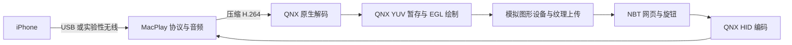

# ID4-Carplay优化版

面向 **原始 BMW HU_NBT / QNX 6.5 x86 本地模拟环境**的 CarPlay 显示、启动和恢复优化。项目名称中的 ID4 对应老款 NBT 的分类；当前验证固件为 `HU_NBT 003_009_004`，不适用于 NBT Evo ID5/ID6。

视频在 QNX 内解码和提交显示；MacPlay 在 Mac 上处理手机协议、音频及物理连接。当前项目没有把完整 CarPlay 协议栈迁入 QNX，也没有向真实车机刷机。



## 已完成的优化

- CarPlay 显示期间持续提交新视频帧，避免每帧都执行完整的原厂 HMI 场景重绘；切回 NBT 时恢复原有流程。
- 使用有边界检查的模拟器共享内存传送已解码 YUV，减少大块像素在图形指令通道中的反复复制。
- 显示线程临时提高优先级，切回原厂菜单后恢复；不更改原有 512 MiB / 1 vCPU 配置。
- 手机接收服务与 QNX 启动并行；冷启动时先让 HMI 完成初始化，再开始视频解码，减少 CPU 争用。
- 原生解码器和 HID 编码器放进本地启动镜像，避免每次启动重复上传。
- 视频通道退出后有退避重试；有持续输入而无解码进展时只恢复视频通道，静态画面不会触发该恢复。
- 接收进程退出时由受控后台监护进程恢复；点击“全部停止”会关闭自动恢复。监护进程不会重启系统蓝牙，也不会自行启动虚拟机。
- 桌面启动器包含两个独立网页按钮、无线测试和切回 USB；开启与重连均不自动打开浏览器。
- 无线模式读取真实 Mac 蓝牙地址及当前 Wi‑Fi 信道，保留已有手机配对。无线实测状态见 [验证记录](docs/VALIDATION.md)。

## 本机验证

动态操作的 24 秒采样：QNX 解码与显示平均均为 **25.46 fps**，HTTP 不同帧取样约 **28.33 fps**，48 次旋钮操作通过，解码与显示错误均为 0。优化前 QNX 显示约 0.2–0.3 fps。

冷启动测得：接收服务约 1.4 秒，手机会话约 3.7 秒，原厂 iDrive 输入约 32.3 秒，首个 QNX CarPlay 画面约 38.1 秒。重复开启约 0.05 秒且保留已建立连接。数据来自 Apple M5、512 MiB / 1 vCPU 的本地模拟环境；不能用于推算实车负载。HTTP 取帧率也不是浏览器屏幕刷新率。

## 部署

本仓库提供优化源码与部署脚本。运行需要已有的本地 NBT/QNX 开发环境、你有权使用的固件和 QNX SDK，以及 [MacPlay 1.2.4](https://github.com/Roylyl/MacPlay/releases/tag/V1.2.4)。完整步骤、现有目录要求和重建顺序见 [部署说明](docs/DEPLOYMENT.md)。

```sh
python3 deploy.py --workspace /path/to/outputs --dry-run
```

通过检查后，先在桌面启动器点击“全部停止”，再按部署说明安装和编译。运行时配置、手机配对、认证文件和固件不会进入 Git。

## `iap.off` 是什么

JayJay3071 项目使用它控制“iPod over Bluetooth”音频/媒体信息路径：

```sh
# 关闭该路径：下一次手机连接服务启动时生效
 touch /var/opt/hmi/data/rw/NbtAndroidAutoRT/iap.off

# 恢复该路径：下一次手机连接服务启动时生效
 rm -f /var/opt/hmi/data/rw/NbtAndroidAutoRT/iap.off
```

这两条是相反的选择，单独执行；第一条末尾不要加 `\` 再接第二条。该开关不负责 Mac 蓝牙配对，也不是无线 CarPlay 开关。当前 MacPlay→QNX 路径的音频由 Mac 处理，无需为了 Mac 蓝牙测试修改它。上游安装/更新程序可能删除这个开关文件。

## 源码与上游

| 部分 | 内容 |
|---|---|
| `runtime/MacPlay-NBT` | MacPlay 独立适配、视频恢复、接收进程监护和无线信息读取 |
| `runtime/CarPlay-QNX-Native` | QNX 解码、显示、HID 与本地镜像准备工具 |
| `runtime/NBT-Launcher` | macOS 桌面控制台 |
| `runtime/NBT-Original/tools` | 本地 VM 生命周期、网页显示和性能采样 |
| `integration` | 本项目编写的共享纹理扩展，以及对已有本地源码的集成工具 |

新编写的源码采用 GPL-3.0-only；保留派生部分的原始说明。第三方依赖及限制见 [NOTICE.md](NOTICE.md)。仓库不收录 BMW 固件、QNX SDK、认证文件、配对密钥或受限上游模拟器源码/二进制。

感谢 [JayJay3071](https://github.com/JayJay3071/nbt-android-auto)、[Valentin Radu](https://github.com/valinet/nbt-android-auto)、[MacPlay](https://github.com/Roylyl/MacPlay) 和 [davisod & JEtsKi](https://github.com/DAviS0d/BMW-NBT-Emulator)。
